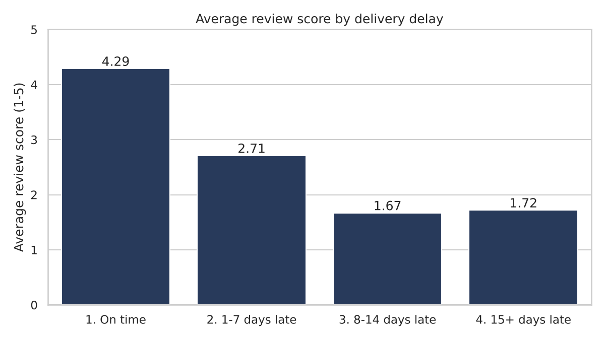
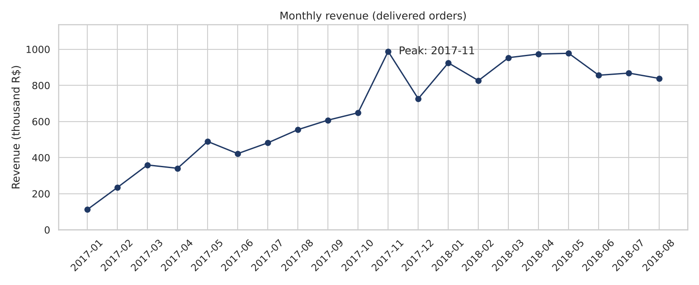
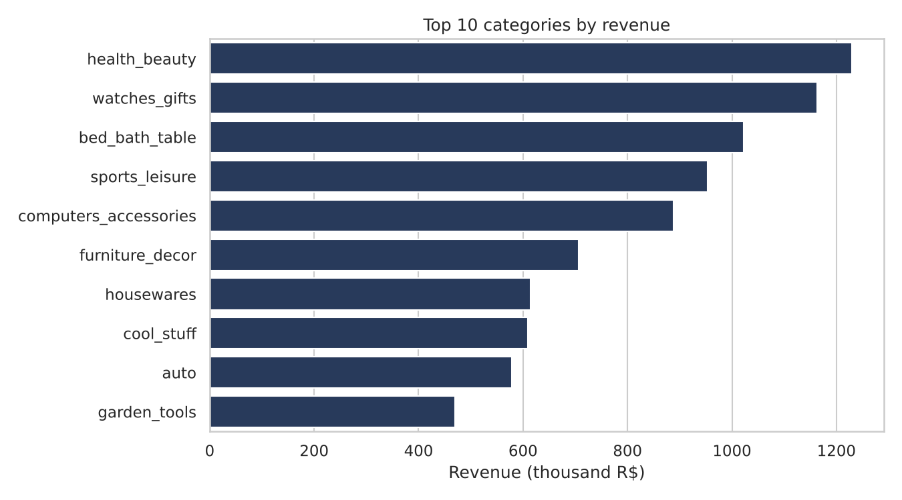

# Olist E-Commerce Sales Analysis (SQL + Python)

Analysis of **~96,000 real orders** from Olist, a Brazilian online marketplace (Jan 2017 – Aug 2018).
The data is spread across 8 related tables, so the analysis combines **Pandas** for cleaning, **SQL** for the business questions and **Matplotlib / Seaborn** for the charts.

**Tools:** Python (Pandas, Matplotlib, Seaborn) · SQL (SQLite) · Jupyter Notebook

## Business questions
1. How did monthly revenue change over time?
2. Which 10 product categories bring the most revenue?
3. Do late deliveries lower customer review scores?
4. How many customers come back and buy again?
5. Which payment methods do customers use most?

## Key insights
1. **Late delivery is the main driver of bad reviews.** 6.7% of orders arrived late. The average review score drops from **4.29** (on time) to **2.27** (late), and the share of 1–2 star reviews jumps from **9%** to about **80%** when an order is more than a week late.
2. **Customer retention is very weak.** **97%** of customers bought only once; only **3%** came back for a second order.
3. **Black Friday drives the biggest spike.** November 2017 was the best month (R$ 988K), with revenue up **52%** over October.
4. **Revenue is concentrated.** The top 3 categories (health & beauty, watches & gifts, bed/bath/table) bring **26%** of all revenue.
5. **Customers pay in installments.** Credit cards are used in **77%** of orders, with an average of **3.5** installments.

**Recommendations**
- Fix delivery estimates and track late orders: it is the fastest way to improve ratings.
- Start a loyalty program or follow-up offers to turn one-time buyers into repeat customers.
- Plan stock and marketing early for Black Friday, focused on the top categories.
- Keep installment payment options visible at checkout.

## Charts

## What I did
- **Data cleaning (Pandas):** converted date columns, kept full months only, removed 551 duplicate reviews, translated product categories to English and labeled 610 products with missing categories.
- **SQL:** loaded the clean tables into SQLite and answered each question with SQL using JOINs, GROUP BY, CTEs, CASE and window functions (`LAG`, `SUM() OVER`).
- **Visualization:** one chart per question, saved in `images/`.

## Project files
| File | Content |
|---|---|
| `olist_analysis.ipynb` | Full analysis: cleaning, SQL, charts and insights |
| `sql/analysis_queries.sql` | All SQL queries in one file |
| `images/` | Charts |

## How to run
1. Download the dataset from Kaggle: [Brazilian E-Commerce Public Dataset by Olist](https://www.kaggle.com/datasets/olistbr/brazilian-ecommerce)
2. Put the CSV files in a folder called `data/`
3. `pip install pandas matplotlib seaborn jupyter`
4. Open `olist_analysis.ipynb` and run all cells
